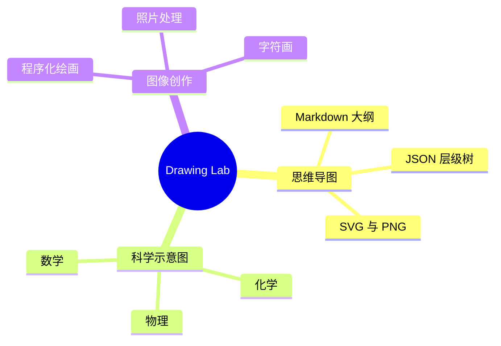

<div align="center">

# Drawing Lab

**一个帮助AI绘制线型图的Skill**

一个面向 AI 工具的绘图 Skill，也是一套可以独立运行的 Python 绘图工具。


[思维导图](#把思维导图画出来) · [安装](#在本地准备环境) · [命令示例](#直接试几条命令) · [完整说明](SKILL.md)

</div>

---

我认为，一张图真正有用的时候，是它把关系讲清楚了，而且下一次修改不必从头重画。Drawing Lab 围绕这个想法整理：知识笔记可以变成思维导图，题目里的条件可以变成几何示意，照片也可以经过一组明确的操作得到新的版本。

我希望你能把它放进自己习惯的 AI 工具里，也能随时打开终端，自己改大纲、调参数、重新出图。这里的 Skill 说明和 Python 脚本各有用处，怎样搭配，可以按你的使用习惯来。

说实话，我更在意图能不能继续用。文字是否完整、中文是否缺字、节点有没有挤在一起、源文件是否保留下来，这些细节比功能列表更能影响使用感受。

在这次整理中，我实际导出了中文思维导图，也在浏览器里检查了 SVG。我发现，把布局检查和真实出图放在一起，许多只看代码时不容易察觉的问题会直接显现出来。这也是我希望这个 Skill 保持的习惯：**画出来，再检查。**

## 能画什么

| 我想做的事 | Drawing Lab 提供的能力 | 主要方式 |
| --- | --- | --- |
| 梳理知识、拆解需求、整理计划 | 思维导图、层级树、中文标签、自动换行 | `mindmap`，导出 SVG / PNG |
| 给题目或讲义配图 | 数学几何、坐标系、函数、辅助线 | `math` |
| 表达物理和化学内容 | 电路、光路、受力、实物、分子、晶胞、反应式和器材 | `physics` / `chem` |
| 展示三维几何 | 立方体、棱锥、棱柱、圆柱和球体等投影图 | `3d` |
| 画统计图、程序化图案 | 柱状图、折线图、散点图、饼图、星空、波纹等 | `chart` / `raster` / `svg` |
| 调整照片或制作拼图 | 基础分析、链式编辑、拼版、混合、文字叠加 | `photo` |
| 把图像变成字符画 | 文本字符画、字符画转图片 | `ascii` |
| 制作网页图形或交互效果 | Canvas / SVG、Three.js、Mermaid、Vega-Lite | 由具备相应工具的 AI 编写代码并实际预览 |

> [!NOTE]
> 本地 CLI 与 AI 工具的网页绘图能力各有适用范围。Three.js、交互式 Canvas、Mermaid 和 Vega-Lite 需要相应的浏览器或渲染环境；它们不是 `drawkit.py` 的同名子命令。

## 把思维导图画出来

这是我很喜欢的一项能力：先把内容写成简单的大纲，图的层级就有了可编辑的来源。

GitHub 可以直接显示下面的 Mermaid 思维导图：



想把自己的内容导出为文件，可以使用仓库里的示例：

```sh
python scripts/drawkit.py mindmap map.svg --input examples/mindmap.md
python scripts/drawkit.py mindmap map.png --input examples/mindmap.md --scale 2
```

也可以把下面的大纲保存为 `notes.md`：

```markdown
# 学习计划
## 数学
- 函数
  - 定义域和值域
  - 单调性
- 几何
## 英语
- 阅读
- 写作
```

```sh
python scripts/drawkit.py mindmap notes.svg --input notes.md
python scripts/drawkit.py mindmap notes.png --input notes.md --layout right --theme dark --scale 2
```

Markdown 输入需要一个 `# 中心主题`。下级标题按层级书写，列表每层缩进两个空格，不使用 Tab；正文段落、代码块和 Markdown 富文本需要先整理成大纲。

| 参数 | 用途 |
| --- | --- |
| `--layout balanced` | 双侧展开，默认布局 |
| `--layout right` / `left` | 所有分支向右或向左展开 |
| `--theme light` / `dark` | 浅色或深色主题 |
| `--font-size` | 字号，范围 10–72，默认 20 |
| `--max-width` | 节点文本宽度，范围 80–600 像素，默认 220，超出后换行 |
| `--scale` | PNG 分辨率倍数，范围 0.5–4，默认 1；SVG 为矢量文件 |

<details>
<summary><strong>我已经有结构化数据：使用 JSON 输入</strong></summary>

将下面内容保存为 `plan.json`：

```json
{
  "text": "产品计划",
  "children": [
    {"text": "用户研究", "children": ["访谈", "反馈整理"]},
    {"text": "交付", "children": ["原型", "验证", "发布"]}
  ]
}
```

```sh
python scripts/drawkit.py mindmap plan.svg --input plan.json
```

节点接受 `text` 和 `children` 字段，叶节点也可以直接写成字符串。输入文件使用 UTF-8 编码。

</details>

思维导图最多包含 500 个节点，根节点以下最多 12 层，每个标签最多 500 个字符；PNG 最多 4000 万像素。我更建议把复杂内容拆成总览和子图，阅读起来也舒服一些。

> [!TIP]
> 我通常更愿意同时保留大纲、SVG 和 PNG：大纲方便改内容，SVG 方便调整文字与路径，PNG 方便分享。SVG 不嵌入字体，换一台设备时可能发生字体替换；PNG 更适合保持最终外观。当前思维导图命令不导出 XMind 原生文件。

详细输入规则见 [思维导图指南](references/mindmap.md)。

## 在本地准备环境

需要 **Python 3.10+**。所有命令都从仓库根目录执行；Linux / macOS 如使用 `python3` 命令，可将示例中的 `python` 替换为 `python3`。

我建议创建虚拟环境，让这个项目的依赖有自己的位置。

<details open>
<summary><strong>Windows · PowerShell</strong></summary>

```powershell
python -m venv .venv
& .\.venv\Scripts\python.exe -m pip install -r requirements.txt
& .\.venv\Scripts\python.exe -X utf8 -B scripts/drawkit.py doctor
```

这些命令直接调用虚拟环境中的解释器。后续也可以用 `& .\.venv\Scripts\python.exe` 执行下文的 Python 命令。

</details>

<details>
<summary><strong>macOS / Linux</strong></summary>

```sh
python3 -m venv .venv
source .venv/bin/activate
python -m pip install -r requirements.txt
python -X utf8 -B scripts/drawkit.py doctor
```

Linux 上构建 PyCairo 可能需要系统 Cairo 开发包和 `pkg-config`。例如 Debian / Ubuntu：

```sh
sudo apt-get install libcairo2-dev pkg-config
```

</details>

只需要核心 Python 绘图功能时，可以按需安装：

```sh
python -m pip install "Pillow>=10.1" "numpy>=1.26"
```

Pillow / numpy 是核心依赖；matplotlib 提供图表，svglib / reportlab / rlPyCairo 提供通用 SVG 栅格化。思维导图本身可以直接生成 SVG / PNG，无需调用外部渲染服务。

### 中文字体

我发现，字体值得在开始绘图前检查。系统需要可用的中文字体，例如 Windows 的 Microsoft YaHei、macOS 的 PingFang，或 Linux 的 Noto Sans CJK。`doctor` 会报告字体发现结果；生成后仍需查看实际图像。

也可以通过 `DRAW_FONT` 指定本地字体文件，具体用法见 [思维导图指南](references/mindmap.md)。仓库不分发字体文件。

<details>
<summary><strong>Windows 的 Python 查找辅助脚本</strong></summary>

```powershell
./bootstrap.ps1 -Action resolve
./bootstrap.ps1 -Action install
./bootstrap.ps1 -Action check-deps
```

脚本依次查找 `DRAW_PYTHON`、已激活的虚拟环境、本 Skill 内的 `.venv`，以及 `PATH` 上的 `python` / `python3`。`DRAW_PYTHON` 可以指定解释器文件或它所在的目录；显式配置或已激活的环境无效时会报错。

`install` 会向选中的 Python 环境安装依赖，建议先创建 `.venv`。脚本不下载 Python，也不要求特定工作区结构。可通过 `DRAW_PIP_INDEX` 指定包索引。

</details>

## 交给 AI 工具使用

如果你使用的 AI 工具支持 `SKILL.md` 约定，可以将完整的 `drawing-lab` 文件夹放入它的 Skills 目录，并按该工具的说明加载。不同工具的目录位置和启用方式可能不同，保留下面这套结构即可：

```text
drawing-lab/
├── SKILL.md
├── bootstrap.ps1
├── requirements.txt
├── scripts/
├── references/
├── examples/
└── tests/
```

对于能读取本地文件、执行命令的 AI 工具，也可以在对话中提供 `SKILL.md` 的完整路径，让它读取说明后使用项目脚本。制作网页图形时，还需要可用的浏览器或渲染工具。

我更喜欢把任务说成具体的交付要求。比如：

> 使用 Drawing Lab，把这份学习笔记整理成思维导图。请保留原有层级和术语，输出 Markdown 大纲、SVG 和 PNG，并检查中文标签与节点重叠。

> 使用 Drawing Lab，画出函数 y = x² − 2 在 −4 到 4 范围内的图像，标出零点，并在 x = 1.5 处添加切线。

我认为，给清楚内容、用途和交付格式，比只说“画得好看一点”更容易得到合适的结果。完整能力选择与检查要求见 [SKILL.md](SKILL.md)。

## 直接试几条命令

```sh
# 函数图：零点、切线与网格
python scripts/drawkit.py math func parabola.png --fn "x**2-2" --xmin -4 --xmax 4 --tangent 1.5 --roots --grid --axis-labels

# 柱状图
python scripts/drawkit.py chart bar sales.png --values 12,30,22,40 --labels A,B,C,D --title "Sales"

# 程序化星空
python scripts/drawkit.py raster stars.png --scene stars --palette neon --width 960 --height 540 --seed 42

# 三维几何投影
python scripts/drawkit.py 3d cube.png --scene cube --yaw 35 --pitch 25 --grid
```

命令行以实际帮助信息为准：

```sh
python scripts/drawkit.py --help
python scripts/drawkit.py mindmap --help
```

输出文件默认拒绝覆盖。再次生成时，请使用新的文件名，或在确认后自行处理旧文件。

## 需要更多细节时

| 主题 | 说明 |
| --- | --- |
| 思维导图 | [输入结构、参数与验收](references/mindmap.md) |
| 数学与辅助线 | [几何 DSL、函数图与坐标系](references/math-figure.md) |
| 物理绘图 | [电路、光路、受力与实物](references/physics-drawing.md) |
| 化学绘图 | [分子、晶胞、反应式与器材](references/chemistry-drawing.md) |
| 三维几何 | [三维投影绘制](references/3d-drawing.md) |
| 照片处理 | [分析、编辑与合成](references/photo-lab.md) |
| Python 绘图 | [图表与程序化画面](references/python-plot.md) |
| SVG / Canvas | [矢量与网页绘图](references/vector-code.md) |
| WebGL / Three.js | [三维网页与动态效果](references/webgl-threejs.md) |
| Mermaid / Vega-Lite | [声明式图表](references/chart-dsl.md) |
| ASCII | [字符画](references/ascii-art.md) |

## 我检查过什么

这次整理完成后，本地 Windows / Python 3.14.7 环境中，56 条命令检查、13 项回归测试和 11 项解释器查找检查均已通过。中文示例的 PNG 已查看，SVG 也已在浏览器中检查，22 个标签没有超出画布或节点边框。

仓库提供 Windows / Linux、Python 3.11 / 3.13 的 GitHub Actions 测试配置。远程执行结果以仓库的 Actions 页面为准。

```sh
python -X utf8 -B tests/test_drawkit.py
python -X utf8 -B -m unittest discover -s tests -p "test_regressions.py"
```

完整命令检查需要安装 `requirements.txt` 中的全部依赖；测试文件使用临时目录生成和清理产物。`doctor` 会报告可选依赖的缺失情况，但只有核心依赖缺失时才返回失败；`bootstrap.ps1 -Action check-deps` 检查完整依赖集合。

### 我希望你知道的边界

科学图像属于教学示意，需要结合题目核对角度、受力、价态、反应条件等具体内容。Photo Lab 提供 Pillow 范围内的分析和编辑，不提供语义修补、人脸识别、超分辨率或智能物体移除；Skill 也不控制已打开的外部绘图应用。

本地 Python 绘图不需要上传内容。依赖安装、CDN 资源和外部渲染服务需要网络；涉及照片或其他私人材料时，应按用户授权范围处理。修改照片时保留原图。

## 一起把它改得更顺手

如果你遇到缺字、节点拥挤、渲染错误，或某个命令和文档对不上，我很愿意从具体例子开始改。提交 Issue 时，附上系统、Python 版本、执行命令、报错信息，以及已经去除私人内容的最小输入，会更容易复现。

准备上传仓库时，请保留隐藏的 `.github`、`.gitignore` 和 `.gitattributes` 文件。虚拟环境、缓存、私人照片和临时生成图不应提交。

### 许可证

当前版本尚未附加 `LICENSE`，许可证需要由发布者确定。字体与第三方库遵循各自的许可证；项目的最终授权范围请以仓库实际提供的许可证文件为准。
