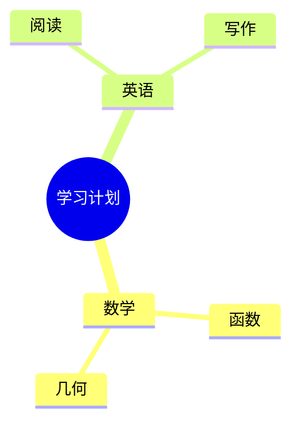

# 思维导图 / Mind maps

适合知识梳理、学习笔记、需求拆解、主题发散、项目分解。流程、因果网络、跨节点关系用 Mermaid 流程图或手绘 SVG；本命令只表达一棵层级树。

## 默认离线路径

```text
python scripts/drawkit.py mindmap map.svg --input examples/mindmap.md
python scripts/drawkit.py mindmap map.png --input examples/mindmap.md --layout balanced --scale 2
python scripts/drawkit.py mindmap tree.png --input tree.json --layout right --theme dark
```

依赖 Pillow；SVG 和 PNG 共用测量后的节点与连线布局，无需上传内容或加载 CDN。默认拒绝覆盖输出文件。`--layout balanced|right|left` 控制一级分支朝向；`--font-size` 为 10–72，`--max-width` 为节点文本宽度 80–600 像素，超长标签自动换行。`--scale` 为 0.5–4，只调整 PNG 分辨率。

## Markdown 大纲

UTF-8 文件必须有一个 `# 中心主题`，可用连续层级的 `##`–`######` 标题和缩进列表。每层列表缩进两个空格，不用 Tab；标题和列表都不能跳级。文字按纯文本处理，不渲染 Markdown 加粗、链接、图片或代码。

```markdown
# 学习计划
## 数学
- 函数
  - 定义域和值域
  - 单调性
- 几何
## 英语
- 阅读
- 写作
```

不要把整篇含段落的 Markdown 文档直接作为大纲；先按原文整理主题与层级。只含一个根节点也有效。

## JSON 树

根节点和分支对象只接受 `text`、`children`；叶节点也可直接写字符串。一个节点可写多行文字（JSON 中用 `\n`）。

```json
{
  "text": "产品计划",
  "children": [
    {"text": "用户研究", "children": ["访谈", "反馈整理"]},
    {"text": "交付", "children": ["原型", "验证", "发布"]}
  ]
}
```

最多 500 个节点，根节点以下最多 12 层；每个标签最多 500 字符。更大的内容应拆成总览和子图。PNG 最多 4000 万像素；超出时减小 `--scale`、拆分图，或选择 SVG。

## 内容与视觉验收

先依据原文保留中心主题、分支归属、顺序、专有名词和不确定项；只有用户要求时才补充内容。每个节点尽量是短语，平行分支保持相近抽象层级。不要为了凑齐分支数量添加事实。

默认一级分支使用不同颜色，后代继承分支颜色；无方向关系的连接线不用箭头。先增大画布或拆分图，再考虑缩小文字。中文缺字时安装中文字体或设置 `DRAW_FONT` 为字体绝对路径，运行 `doctor` 检查；不下载来源不明的字体。

实际打开生成的 PNG，检查标签、层级、换行、留白与连线；SVG 在目标查看器中也要预览。SVG 使用本地字体的名称，不嵌入字体；跨设备查看时可能替换字体，因此同时提供 PNG。交付大纲/JSON 和最终图像，说明布局或拆分依据。SVG 可以编辑文字和路径；不宣称可直接编辑为 XMind、FreeMind 等原生格式。

## 需要 Mermaid 源码时



用空格缩进，节点文字应简短并避开语法保留符。复杂标点或长文字优先走 JSON → SVG/PNG。Mermaid 需支持 `mindmap` 的版本和实际渲染器；GitHub/编辑器是否支持应以目标环境预览为准。
